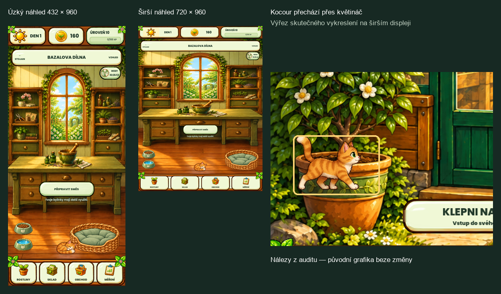

**Bazal’s Pocket Garden — audit projektu, 22. 10. 2026**

Audit aktuálního pracovního stromu v `R:\_projekty\Bazal's Pocket Garden`, větev `fix/rc61-feedback-motion`, základní commit `ed58703`. Posuzována byla místní verze včetně dosud necommitovaných změn. Produkční kód, grafika, herní postup ani schválené reference nebyly upraveny. Vznikly pouze izolované testovací sondy a tato zpráva.

**Potvrzené závady a potřebné kroky**

1. **P1 — ochrana jediné zálohy při chybějícím hlavním save.** Pokud hlavní uložená hra neexistuje a záloha pochází z novějšího schématu, načítání ji ignoruje, vrátí novou hru s 30 mincemi a povolí zápis. První uložení vytvoří novou hlavní kopii; druhé přepíše původní novější zálohu. Izolovaná reprodukce: schéma 47 → nová hra → dvě úspěšná uložení → záloha má schéma 46 a původní data zmizela. Jde o podmíněnou ztrátu postupu, například při návratu ke starší verzi bez hlavního souboru; nikoli o tvrzení, že běžné ukládání vždy maže hru. Je potřeba rozlišit chybějící, nečitelnou a nepodporovanou zálohu, chránit poslední existující data a přidat regresní test.

   Zdroj: `scripts/save_manager.gd:329–336`, povolení zápisu `:302`, přepis zálohy `:221–245`. Důkaz: [save-probe-result.json](save-probe-result.json), sonda `tmp/project-audit-20261022/save_probe.gd`. Kontrolní případy s poškozeným existujícím hlavním save správně blokují zápis; platný hlavní save zůstává autoritativní.

2. **P2 — kocour prochází přes květináč před skleníkem.** Na širším rozložení, výrazně při 720 × 960 a také při 600 × 900, je úroveň chůze výše než spodní hrana velkého květináče. Kocour se přitom kreslí před celým pozadím. Výsledkem je chůze po těle květináče. Trasa potřebuje reagovat na skutečně zobrazenou cestu a překážky, případně použít překrývající vrstvu. Samotné zmenšení kocoura problém neřeší.

   Zdroj: `scripts/ui/garden_cat_companion.gd:352–354`, `:385–390`; `scripts/main.gd:1059`. Důkaz: [celý snímek 720 × 960](exterior-cat-100-720x960.png), zvýrazněný výřez níže. Jde o nativně vykreslený dosažitelný bod trasy s deterministicky zastaveným animačním snímkem, nikoli o ručně vložený obrázek kocoura.

3. **P2 — deformace malované dílny na širších displejích.** Celá malba se roztahuje na obdélník ovládacího prvku bez zachování poměru stran. Úzké rozložení 432 × 960 odpovídá zdroji přibližně, při 720 × 960 se však okno, zásuvky i pracovní pomůcky viditelně rozšíří. Kocour, misky a tlačítka mají vlastní měřítko, takže se vůči pozadí mění proporce. Je potřeba jednotně navrhnout zachování proporcí a umístění interaktivních prvků, se schválením náhledu před integrací.

   Zdroj: `scripts/ui/workshop_room_view.gd:181`. Důkazy: [432 × 960](workshop-room-432x960.png), [540 × 960](workshop-room-540x960.png), [720 × 960](workshop-room-720x960.png). Jde o logické velikosti plátna v desktopovém rendereru, nikoli fyzický test telefonu.

4. **P2 — výkonnostní kontrola neodpovídá současné dílně.** Oficiální `run_performance_smoke.ps1` skončil `FAILED`. Scénář `player_room_drag` hledá přesouvatelnou obsazenou buňku původního pokoje, přestože schválená dílna má pevnou malovanou kompozici a přesouvání vypnuté. Nastavení scénáře je neplatné: `Drag source is not a reachable occupied plant cell`, nula zaznamenaných pohybů. U tohoto scénáře navíc monitor CPU p95 překročil limit 20 ms hodnotou 24,123 ms. Z takového měření nelze vyvozovat reálné zasekávání dnešní hry. Je potřeba zachovat limity, nahradit neplatný scénář aktuálními interakcemi a začlenit čajovnu, kocoura, motýly a venkovní dekoraci do pravidelné matice.

   Zdroj: `tools/performance_smoke.gd:25`, `:188`, `:264`; pevná kompozice `scripts/ui/workshop_room_view.gd:167–170`. Důkaz: [performance-summary.json](performance-summary.json). Šest platných běžných scén prošlo. Dodatečné měření nových scén je popsáno níže.

5. **P2 — zbytečné závislosti při načítání hry.** Dílna dědí původní renderer pokoje, jehož šest velkých maleb se stále načítá přes `preload`, ačkoli nový `_draw()` kreslí výhradně dílnu. Nominální dekódovaná obrazová data těchto šesti textur včetně mipmap představují přibližně 31,26 MiB. Je vhodné oddělit historické referenční vykreslování od produkční dílny nebo obrázky načítat až při skutečném použití. Zachovat přitom vlastnictví dekorací a staré reference. Část dalších atlasů je také výrazně větší než jejich zobrazení, například dvě misky mají každá 1536 × 1024 px při zobrazení nejvýše 76 logických px.

   Zdroj: `scripts/ui/workshop_room_view.gd:1`, `scripts/ui/player_room_collection_view.gd:19–24`. Podrobnosti: [assets-audit.txt](assets-audit.txt). Číslo 31,26 MiB je statický výpočet dekódovaných obrazových dat, ne naměřená úspora RAM, VRAM nebo času startu. Skutečný přínos je nutné změřit po případné opravě.

6. **P3 — nepotřebná grafika v instalačním balíku.** Poslední místní x86_64 APK má 276,34 MiB a obsahuje čtyři zastaralé obrázky o celkové komprimované velikosti 5,80 MiB: starého jantarového motýla, společný původní kočičí koutek, prázdnou variantu dílny a interiér skleníku phase120. U prvních tří nebyl nalezen produkční odkaz; čtvrtý se vyskytuje pouze jako historický metadatový popisek, skutečné pozadí je phase130. Po kontrole závislostí je možné je vyloučit z exportu bez mazání zdrojů.

   Zdroj: `export_presets.cfg:9–11`; konkrétní názvy archivovaných položek, velikosti a SHA v [assets-audit.txt](assets-audit.txt). Auditovaný balík: `builds/android/bazals-pocket-garden-20261022-tea-tree-x86_64.apk`. Velikost x86_64 testovacího APK není velikostí budoucího distribuovaného arm64 balíčku z obchodu.

7. **P2 — současná práce není celá zachycená v Gitu.** Na začátku auditu bylo 229 položek pracovního stromu se změnami. Mezi nesledovanými soubory je 75 souborů pod `scripts`, 191 pod `assets` a 32 pod `tests` včetně doprovodných UID/import souborů. Nové funkce a jejich důkazy tedy nejsou celé reprodukovatelné z aktuálního commitu. Je potřeba změny rozdělit, prověřit a cíleně commitovat a zálohovat; nikoli přidat všechny pracovní soubory najednou. Tento audit neprovedl push ani neověřoval živý stav všech větví GitHubu.

**Kontroly, které je ještě potřeba doplnit**

- **Export zálohy neověřuje dokončení zápisu.** `scripts/save_manager.gd:78–88` po úspěšném otevření souboru zavolá `store_string`, `flush`, `close` a bez další kontroly vrátí „bezpečně exportována“. Chybí kontrola chyby zápisu a/nebo přečtení a ověření výsledných dat. Jde o potvrzenou mezeru v obsluze I/O, nikoli o při tomto auditu vyvolané zaplnění disku. Doplnit bezpečný zápis a test selhání úložiště.
- **Zelený výsledek funkčních testů nezaručuje čistý protokol.** Testy obsahují 68 řádků `ERROR`, z toho 18 patří očekávaným negativním scénářům. Zbývá 10 diagnostik shaderového kompilátoru v headless režimu a 40 přístupů k chybějícím metadatům testovacích tlačítek (`action_content`, `action_icon`). Tyto dvě skupiny je potřeba odstranit nebo přesně odlišit od záměrných chyb; nespolehlivý by byl i prostý zákaz všech `ERROR`. `tools/run_tests.ps1:54–56` dnes odmítá pouze vybrané typy chyb. V dodatečném nativním vykreslení těchto 103 snímků nebyla žádná chyba; nejde o důkaz pádu motýlů ve skutečné hře.
- **Rozšířit vizuální pokrytí aktuálních obrazovek.** Stávajících 34 referenčních bran prošlo, ale to automaticky nepokrývá všechny nové stavy dílny, venkovní scény a čajovny. Doplnit jejich schválené náhledy a geometrické testy, zejména široký poměr, bezpečné okraje a hloubku trasy kocoura. Při auditu se žádná reference ani tolerance neměnila.

**Co bylo skutečně ověřeno**

| Kontrola | Výsledek a omezení |
| --- | --- |
| Plná kanonická validace | `MVP_TESTS_PASSED=8251`, `HOW_TO_GROW_VALIDATION=PASSED`; protokolové diagnostiky jsou uvedeny výše. |
| Vizuální porovnání | 34/34 bran prošlo, všech 54 referenčních PNG má původní SHA-256. |
| Responzivní testy | 15/15 standardních scénářů prošlo včetně bezpečných okrajů. |
| Kontrola vizuálních profilů | `VISUAL_CONTRACT_AUDIT=PASSED`, 618 profilovaných PNG, žádné neprofilované. Jde o klasifikaci assetů, nikoli posouzení krásy každého obrazu. |
| Dodatečné nativní náhledy současné hry | 103 snímků na plátnech 360×800, 432×960, 540×960, 600×900, 720×960 a se simulovanými horními/spodními bezpečnými okraji. Stojan, dílna, skleník venku/uvnitř, dekorace, detail levandule, herbář, denní výzva, nastavení, sklad, obchod, měření, recepty, výrobky, čajovna a kolo štěstí. Žádný `ERROR` v nativním capture protokolu. |
| Textury rostlin | Všech 66 cest v 11 profilech existuje; žádné zdrojové PNG nemá neprůhledný obsah přitisknutý ke hraně při alpha > 32. V pořízených detailech levandule nebyl nalezen ořez. Nejde o důkaz všech možných časových fází každé animace. |
| Kocour a motýli | Staticky ověřeno jednotné anatomické měřítko 40 póz, zákaz skladu/obchodu, reakce na pauzu a omezení pohybu; motýli používají synchronizovaný list 4×3 a auru. Potvrzená chyba hloubky venkovní trasy je uvedena výše. |
| Odměny a transakce | Kontrola návratu změn při chybě u kola štěstí, výrobků a čajovníku, ochrany duplicit a UTC resetu. Čajovna záměrně nepřiděluje zahradní odměny. Bez nové potvrzené chyby v prověřených cestách; placená reklama nebyla na zařízení testována. |

Samostatné nové výkonnostní sondy na tomto Windows PC, NVIDIA RTX 3050 Ti, Compatibility renderer, limit 60 FPS:

| Scéna | CPU p95 | Čas snímku p95 | Draw calls | Výklad |
| --- | ---: | ---: | ---: | --- |
| Exteriér, čajovník, aktivní kocour a motýli | 8,202 ms | 16,727 ms | 136 | Splnilo stávající limity. |
| Čajovna, první měření | 23,330 ms | 16,703 ms | 249 | Překročilo pouze CPU proxy 20 ms, skutečný čas snímku zůstal v limitu. |
| Čajovna, jedno samostatné opakování | 6,256 ms | 16,705 ms | 249 | Splnilo stejné limity; první CPU výsledek se neopakoval. Oba výsledky jsou ponechány v důkazech. |

Podklady: [new-scenes-performance.json](new-scenes-performance.json), [teahouse-performance-retry.json](teahouse-performance-retry.json). Krátké měření není dlouhodobým testem zahřívání ani fyzickým Android testem; neobsahuje všechny tahy a efekty minihry.

**Nepotvrzené nebo neprovedené**

Příčina dříve pozorovaných nulových souborů v emulátoru nebyla prokázána. Standardní zdrojový zápis používá ověřený dočasný soubor a nebyl nalezen přímý přepis obou kopií nulovými daty. Tento incident nelze zaměňovat s výše reprodukovanou chybou nepodporované zálohy. Audit neinstaloval aplikaci, nepřepisoval uživatelský profil, nespouštěl fyzický telefon a nezměnil stav GitHubu. Nové nativní náhledy a sondy používají oddělené APPDATA; uložené fixture soubory mají jedinečné cesty pod `tmp/project-audit-20261022`.

**Doporučené pořadí další práce**

Nejdříve opravit ochranu uložené hry a ověření exportované zálohy. Poté srovnat trasu kocoura a proporce dílny na širších poměrech. Následně aktualizovat výkonové a vizuální testy podle dnešní hry, omezit nepotřebné načítání a export, a po ověření cíleně uložit současnou práci do Gitu. Změny vzhledu předložit ke schválení a zachovat uložený postup.

Úplné pracovní důkazy: `tmp/project-audit-20261022/validation/report.md`, `validation/tests.log`, `capture-geometry.json`, `captures/`, `.godot/responsive/20261022-212856Z/responsive-layout.json`, `.godot/performance/20261022-212908Z/performance-smoke.json`, `.godot/visual-contract/20261022-213011Z/visual-contract.json`. Strojový souhrn: [evidence.json](evidence.json).
