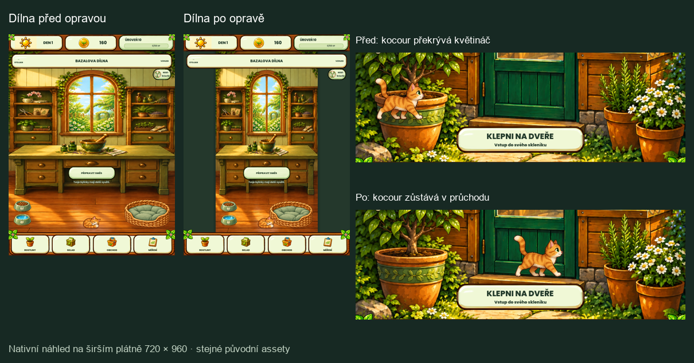

**Bazal’s Pocket Garden — opravy auditu, 23. 10. 2026**

Opravy místní verze v `R:\_projekty\Bazal's Pocket Garden`, větev `fix/rc61-feedback-motion`, výchozí commit `ed58703`. Práce navazuje na [audit z 22. 10.](../20261022-project-audit/README.md). Širší dílnu se zelenými bočními okraji i ukázaný průchod kocoura majitel výslovně schválil v chatu.

**Co je opravené**

| Oblast | Výsledek |
| --- | --- |
| Ochrana poslední uložené kopie | Chybějící hlavní soubor už neznamená zapisovatelnou novou hru, pokud existuje nepodporovaná, prázdná nebo poškozená záloha. Zápis se zablokuje a původní soubory zůstanou zachované. Platná hlavní kopie zůstává autoritativní; podporovaná záloha se nadále obnoví. |
| Export přenosné zálohy | Úspěch se vrací až po kontrole výsledku zápisu, počtu bajtů a opětovném otevření, přesné shodě obsahu a ověření obálky včetně SHA-256. Chybějící nebo zkrácený výsledek není úspěch. |
| Kocour před skleníkem | Na širokém poměru se kocour, jeho stín, myš a prach vykreslují pouze v bezpečném průchodu mezi předními květináči. U krajů průchodu se plynule ztrácejí. Oprava vychází z polohy skutečně zobrazené malby; nepoužívá novou masku siluety ani navigaci kolem překážek. Telefonní trasa, anatomické měřítko, ostatní animace a zákaz skladu/obchodu zůstávají zachované. |
| Široká dílna | Širší plátno drží proporce původní malby a přidává tlumené zelené boční okraje. Pelíšek, misky i kočičí pozice sledují malovanou podlahu. Schválené telefonní rozložení 360×800 a 432×960 se nemění. |
| Historické textury pokoje | Šest původních maleb se načítá až při skutečném použití historického rendereru. Současná dílna je nenačítá; její mezipaměť těchto textur je ve všech pěti zkoušených velikostech prázdná. Historické reference i data vlastnictví dekorací zůstávají. |
| Pravidelná výkonová kontrola | Neplatný scénář přesouvání dekorací nahradily současné interakce dílny. Matice obsahuje také exteriér s čajovníkem, aktivními motýly a kocourem a hraní čajovny dotykovými tahy. Během měření kontroluje skutečně otevřenou scénu a zachování ekonomických dat. Původní limity se nezmírnily. |
| Testovací diagnostiky | Opraveny přístupy k chybějícím metadatům a předávání shaderových samplerů motýlů a větvičky. Testovací runner nyní odmítá neznámé chyby i v protokolu s úspěšným markerem. Povoluje pouze 18 přesných zpráv záměrných negativních testů, každou nejvýše jednou; při importu žádnou. |
| Nepotřebné obrázky v exportu | Všechny tři exportní presety vylučují čtyři přesně určené staré obrázky. Nový Android resource ZIP neobsahuje jejich importy ani převedené textury. Současné kočičí listy, motýli, čajovník a malba dílny v něm jsou. Zdrojové obrázky se nemažou. |

Uložená hra nadále používá schéma **46**. Opravy nemění ekonomiku, herní pravidla ani migrace postupu. Testy a nativní sondy běžely s oddělenými APPDATA a testovacími soubory; tento průchod neupravoval skutečný profil hráče.

**Ověření**

| Kontrola | Skutečný výsledek |
| --- | --- |
| Zaměřené testy ukládání a exportu | **34 kontrol, 0 selhání**. [Protokol](save-focused.log). Testují i opakované pokusy o zápis přes chráněnou jedinou kopii, platnou obnovu a autoritu hlavního souboru. |
| Kompletní funkční sada | **8 306 kontrol prošlo**. Přibylo 18 kontrol ochrany zálohy/exportu a 37 kontrol geometrie. [Protokol](tests.log), [markery](validation-status.txt). |
| Chybové diagnostiky | **0 neočekávaných**, pouze 18 přesných negativních scénářů. Samostatná kontrola pravidel protokolu: **15/15** včetně odmítnutí duplicit, přidaného textu a neznámé chyby navzdory úspěšnému markeru. [Výsledek](test-diagnostics.json). |
| Kanonické vizuální porovnání | **34/34 platných bran**, všech **54 referenčních PNG beze změny SHA-256**. Dalších 20 koncepčních porovnání zůstává pouze informativních; reference ani tolerance se neměnily. [Strojový výsledek](canonical-visual-report.json). |
| Nové nativní porovnání | Telefonní dílna ve dvou velikostech a motýli v pěti velikostech mají **0 změněných pixelů scény pod horním 72px HUD**. Rozdíly celého snímku jsou pouze v časově proměnlivých ozdobách horních rohů. Shader větvičky: **6 nativně zachycených fází, v každé přesná shoda všech pixelů**. [Výsledky](visual-checks.json). |
| Responzivita | **15/15** standardních scénářů bezpečných okrajů. Nové geometrické kontroly navíc pokrývají plátna 360×800, 432×960, 540×960, 600×900 a 720×960. [Výsledek](responsive-layout.json). |
| Vizuální profily assetů | **618 profilovaných PNG, 0 neprofilovaných**. Jde o kontrolu klasifikace, nikoli posouzení vzhledu každého obrazu. [Výsledek](visual-contract.json). |
| Nativní výkonová matice | **9/9 scénářů prošlo**. Nejvyšší CPU p95 **18,201 ms**, čas snímku p95 **16,768 ms**, nejvýše **421 draw calls**, statická paměť **118,15 MiB**. Windows, RTX 3050 Ti, Compatibility renderer, limit 60 FPS; 120 zahřívacích a 360 měřených snímků na scénář. [Výsledek](performance-smoke.json), [protokol](performance.log). |
| Export herních prostředků | Úspěšný Android resource ZIP: **1 135 položek**, **193 483 721 bajtů**. Ověřena nepřítomnost čtyř starých assetů i přítomnost pěti současných. Přesné názvy, SHA-256 archivu a zachované zdroje: [kontrola balíku](resource-pack-check.json). |

Nejprve proběhla úplná kanonická validace včetně nových nativních snímků. Po poslední opravě vazby sampleru větvičky proběhla znovu úplná funkční sada a porovnání již zachycených snímků; větvička, která není součástí kanonických bran, byla samostatně znovu nativně zachycena ve šesti fázích. Konečné měření výkonu i export používají poslední zdrojovou verzi.

**Schválené náhledy**

[Animovaná ukázka průchodu kocoura](cat-passage.mp4). Jde o nativně vykreslenou deterministickou ukázku skutečné komponenty, nikoli záznam ovládání hráčem.

**Meze ověření a zbývající práce**

- Fyzický Android ani instalace do emulátoru se v tomto průchodu neprováděly. Export prostředků není sestavení APK ani důkaz chování Android úložiště nebo dlouhodobého výkonu telefonu.
- Nebylo fyzicky vyvoláno zaplnění disku ani výpadek napájení. Kontrola exportu odhalí neúplný výsledek, ale přepis přenosné zálohy není atomický. Nepotvrzená příčina dřívějších nulových souborů v emulátoru zůstává neprokázaná.
- Nominálních 31,26 MiB historických obrazových dat již není součástí okamžitého načítání dílny. Není to naměřená úspora RAM, VRAM ani času startu. Další změny rozlišení atlasů nejsou součástí této opravy.
- Bod auditu o Gitu zůstává otevřený: projekt měl rozsáhlé předchozí necommitované změny. Tento průchod je nezahrnul do hromadného commitu, neprovedl push a nevytvořil release. Před publikací je potřeba předchozí práci rozdělit a cíleně prověřit. Současný commit sám o sobě nereprodukuje celou místní verzi.

Úplný strojový souhrn včetně otisků 21 změněných zdrojových souborů: [verification.json](verification.json). Původní verze dotčených souborů a úplný pracovní projekt pro srovnání jsou zachovány v izolované složce `tmp/audit-repairs-20261023`; velké testovací profily a resource ZIP nejsou součástí této dokumentace ani publikovaného balíku.

**Navazující schválený krok:** rozdělení práce do commitů a aktualizaci emulátoru dokládá [následná zpráva](../20261023-github-emulator/README.md). Výše popsané meze zaznamenávají stav při dokončení samotné opravy; výsledky následné instalace jsou vedené samostatně.
