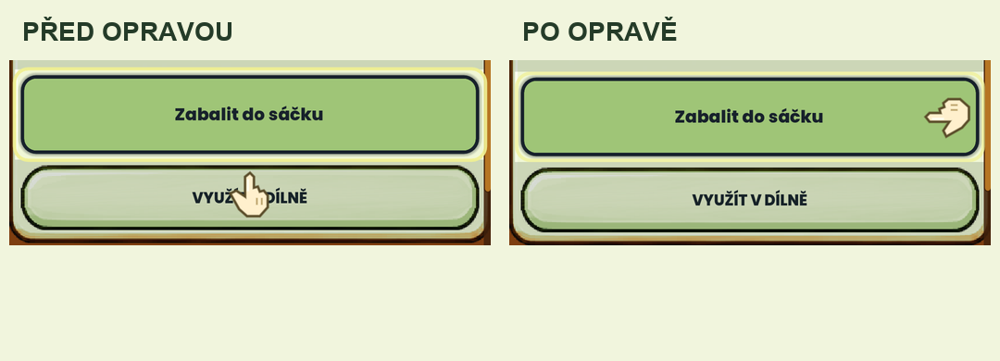

# Opravy pěti nálezů z emulátoru — 23. 10. 2026

Navazuje na [původní audit](../20261023-emulator-walkthrough/README.md). Všech pět potvrzených nálezů je opraveno ve zdroji a znovu ověřeno nativním ovládáním aktualizovaného Android APK. Původní audit zůstává historickým záznamem.

| ID | Oprava | Ověření |
|---|---|---|
| A01 | Systémové Zpět zavře nejdříve otevřený výběr OptionButton. | Dvakrát otevřen výběr tonika, Zpět ponechalo recepty otevřené, další Zpět vrátilo dílnu. Totéž pro dlouhý výběr sklizně ve skladu. [Video](evidence/back-popup-fixed.mp4). |
| A02 | VIBRATE je ve všech exportních předvolbách, zdrojovém manifestu a kontraktu balíčku. | Nový podepsaný APK prošel úplnou kontrolou exportu; Android uděluje VIBRATE a služba eviduje dokončené impulzy hry. Čerstvé procesní logy neobsahují původní SecurityException. [Důkaz](android-haptics.txt). |
| A03 | Náhledy všech čtyř vzhledů používají aktuální malbu dílny a její skutečné barevné tóny; popisy již neslibují neexistující bubliny/girlandu. | V testovacím profilu koupena tyrkysová varianta za původních 35 mincí: [náhled a vlastnictví](evidence/showroom-lagoon-owned.png), [výsledná dílna](evidence/workshop-lagoon-matching-preview.png). Ceny, ID, odemčení a uložené vlastnictví beze změn. |
| A04 | Správné tvary semínko / semínka / semínek. | Skutečný Android výběr zobrazuje [1 semínko](evidence/seed-selector-single-fixed.png). Presenter testován pro 0, 1, 2, 3, 4, 5, 11 a 21 bez změny zásob. |
| A05 | Ručka tutorialu hledá místo s ohledem na text, sousední akce, profesora a celý rozsah pohybu. | Balení nepřekrývá následující akci, včetně 1080×2040 a omezeného pohybu. Skutečný dotyk zabalil úrodu a navázal prodej. [Animace](evidence/tutorial-hand-fixed.mp4), [provedení akce](evidence/tutorial-package-action.mp4), [kratší obrazovka](evidence/tutorial-hand-compact.png). |

## Automatické ověření

- Import a kompletní funkční sada: **MVP_TESTS_PASSED=8333**. Obsahuje regrese nabídky tonika a skladu, neměnnosti zásob, skutečného presenteru semínek, geometrie ručky a shody zdroje/tónu náhledů.
- Deterministické snímky byly pořízeny úspěšně. **33/34 vynucovaných vizuálních bran prošlo.** Jediná odchylka je `phase162-cosmetic-showroom-runtime-approved`: MAE 14.092, RMSE 35.358, změněná plocha 26.980 %. Jde o záměrně opravené náhledy a popisy vůči staré referenci.
- Celý vizuální běh proto poctivě zůstává **FAILED**, nikoli zelený průchod. [Úplný report](visual-report.md), [porovnání showroomu](evidence/showroom-visual-comparison.png). Schválené reference, prahy a manifest porovnání se neměnily. Tento náhled ještě není novou uživatelsky schválenou referencí.
- Kontroly Android exportu prošly: podpis a jeho původní identita, ABI, manifest/oprávnění, obsah balíčku, testovací reklamní SDK a 16KB zarovnání. [Log](android-export.txt).

## Zachování profilu a meze

Aktualizace proběhla přes `adb install -r`. Původní adresář `files` byl po celou dobu oddělený od testovacích profilů. Před spuštěním aktualizované hry bylo všech **30 původních souborů shodných po bajtech** s předtestovou kopií; poté probíhá běžný offline postup. Testovací nákupy a tutorial nebyly přeneseny do hráčova profilu. Rozlišení je vráceno na 1080×2400 a [hra běží s původním profilem](evidence/original-game-running.png).

Instalovaný APK: `builds/android/bazals-pocket-garden-20261023-audit-fixes-x86_64.apk`, SHA-256 `e145c6fd22fa29cfe8893722f62af44a47d1daa4b0a17eb1e4e4ce47715dfc90`. Výchozí commit je `c113d7bf`; opravy jsou pracovní změny. Nevznikl nový commit, push ani release.

Tento průchod znovu ověřuje pět nalezených závad a navazující chování; není opakováním celého prvotního auditu všech obrazovek. Nativní videa nemají zvuk. Fyzický telefon ani síla vibrací nebyly testovány. Podrobné testovací logy, původní soubory a pomocné profily jsou lokálně v ignorované složce `tmp/emulator-fixes-20261023`; nejsou součástí této zprávy.

## Následné zveřejnění — 24. 10. 2026

Předchozí odstavce zaznamenávají stav při původním ověření. Po souhlasu majitele byly opravy rozděleny do commitů `bd9ecad` (Android oprávnění), `252566e` (UI a regrese) a `8fe38d8` (auditní důkazy) a nahrány do větve `fix/rc61-feedback-motion`. [GitHub Actions 40056211270](https://github.com/plokik/bazals-pocket-garden/actions/runs/40056211270) nad přesným SHA `8fe38d807249f187f4f422db7a7583f0d46d9a21` úspěšně dokončily 8 333 funkčních kontrol a statický kontrakt původních referencí. Běh CI neprovádí úplné GPU vizuální porovnání; výše uvedená jediná očekávaná odchylka showroomu zůstává zdokumentovaná a reference nezměněná. Release nevznikl.
