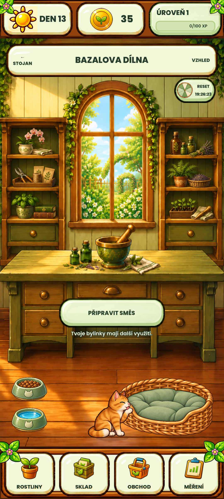

**Commitované zdroje a aktualizace emulátoru — 23. 10. 2026**

Předchozí rozpracovaná hra a schválené opravy jsou uspořádané na větvi `fix/rc61-feedback-motion`. Výchozí commit byl `ed58703`. Výchozí větev byla před zahájením shodná s GitHubem; historie se nepřepisuje.

| Commit | Obsah |
| --- | --- |
| `b0a9ac0` | Schválená grafika, zvuky, zdrojové prompty, vizuální historie návrhů a nástroje pro jejich přípravu. |
| `9b75666` | Kocour, venkovní skleník a čajovník, dílna a čajovna, kolo štěstí s testovacími reklamami, zvuková kulisa, úvodní tutorial a související testy. |
| `a52157a` | Ochrana uložené hry a exportu zálohy, široké rozložení dílny a průchod kocoura, odložené načítání historické grafiky, přesné kontroly diagnostik a současná výkonová matice. |
| Tento dokumentační commit | Původní audit, výsledky oprav a doklady aktualizace emulátoru. |

Nové commity obsahují skutečné dříve nesledované soubory potřebné k běhu hry. Pythonové cache se ignorují; klíče, instalační balíky, testovací profily, raw zálohy hráče a dočasné pracovní kopie zůstávají mimo Git. Kontrola 681 textových souborů nenašla běžné vzory soukromých klíčů a přístupových tokenů; nejde o úplný bezpečnostní audit. Historické protokoly jsou zachované včetně původního formátování a koncových mezer.

**Ověření zdrojů**

Byla vytvořena samostatná úplná kopie z `git archive a52157a`, bez převzetí původní `.godot` cache. Statické kontroly doložily 375 runtime odkazů na existující prostředky, tři konzistentní Android presety a schéma uložené hry 46. Všechny potřebné runtime komponenty, assety a testy jsou součástí commitů.

První import této čisté kopie na tomto Windows PC nativně spadl během importu fontů. Windows zaznamenal výjimku Godotu **0xc0000005**. Tento běh je ponechaný jako **neúspěšný**, příčina není prokázaná. Opakovaný běh nad již částečně naplněnou importní cache dokončil celou CI sadu:

- `STARTUP_PREFERENCES_SMOKE=PASSED` a `PREPARED_STARTUP_ASSETS=PASSED`;
- `VISUAL_CONTRACT_AUDIT=PASSED`;
- `MVP_TESTS_PASSED=8306`;
- `CI_GOLDEN_READ_ONLY=PASSED`, 54 případů, 34 aktivních bran, původní připnutý digest;
- `HOW_TO_GROW_CI=PASSED`.

[První neúspěšný běh](ci-first-import-failed.log) a [celý úspěšný běh](ci-retry-passed.log) jsou uvedené odděleně. Úspěch opakování není tvrzením, že první zcela čistý import proběhl bez chyby. Následný vzdálený běh lze ověřit v [GitHub Actions pro tuto větev](https://github.com/plokik/bazals-pocket-garden/actions?query=branch%3Afix%2Frc61-feedback-motion).

Zdrojový runtime se proti [předchozí úplné funkční, vizuální a výkonové validaci](../20261023-audit-repairs/README.md) nezměnil. Ta doložila 8 306 kontrol, 34/34 vizuálních bran, 9/9 výkonových scénářů a 54 nezměněných referenčních PNG. Nebyly vytvořené ani přepsané vizuální reference.

**Android emulátor**

Nový debug APK byl sestaven z těchto zdrojů pro `Bazal_Current_Source_API36`, Android 36 / x86_64, balík `com.howtogrow.game`, verze `0.71.0-rc61-emulator`, kód 78. Má **270,54 MiB**, SHA-256:

`f50f9a1c4ad277682ce884e22dc4b382222e1bb686a96ee588eb0ec5abd3c2c9`

Prošel kontrolami podpisu a jeho identity, ABI, obsahu, vyloučených QA podkladů, manifestu, notifikačních tříd, povolených SDK a 16KB zarovnání. [Markery sestavení](android-build-checks.txt).

Před aktualizací byly oba existující save validní JSON se schématem 46. Aplikační soubory byly archivovány do ignorované složky `tmp/publish-emulator-20261023/emulator`. Následovalo **`adb install -r` bez odinstalace nebo vymazání dat**. Ještě před spuštěním hry byly oba save po bajtech totožné s původními soubory. SHA-256 nainstalovaného `base.apk` souhlasí s novým APK. [Doklad zachování](android-save-preservation.json) neobsahuje raw hráčská data.

Spuštění vrátilo `Status: ok`; je vidět aktuální dílna se stávajícím profilem. Proces nevykázal chybu skriptu, parseru, Java pád ani selhání kompilace shaderu. Při prvním spuštění se jednou objevilo upozornění na starou shaderovou cache a její opětovnou kompilaci; není zaměňováno za bezchybný protokol. Uživatel má hru ponechanou otevřenou.

Jde o aktualizaci existující zdrojové větve a lokálního emulátoru. Nový release ani sloučení do `main` nejsou součástí tohoto kroku. Fyzický telefon, dlouhodobé zatížení Androidu a reklamní síť v produkčním režimu nejsou tímto dokladem ověřené. [Strojový souhrn](verification.json).
