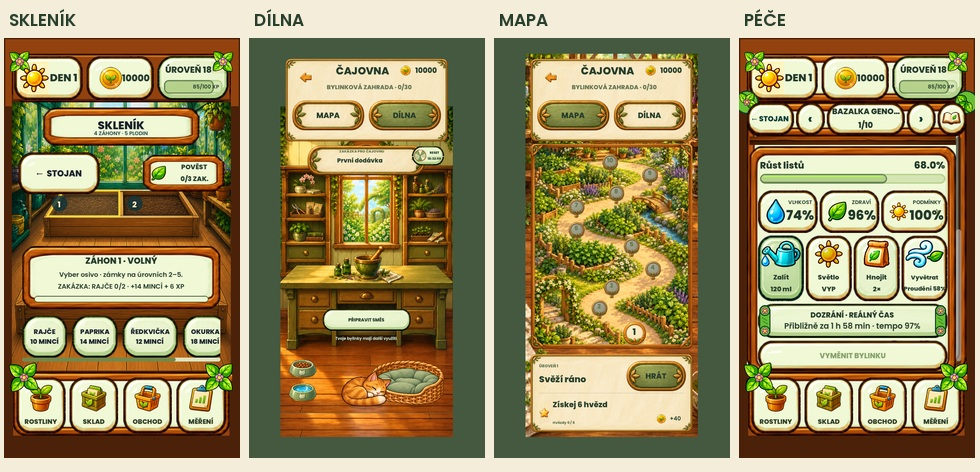

# Původní obrazovky obnovené

**Historický průchod, později nahrazený.** Uživatel následně vysvětlil záměnu a výslovně požádal znovu o novou verzi z přehledového obrázku. Ta je nyní [obnovená zde](../../visual-proposals/20261028-remaining-fixes/README.md). Níže uvedené výsledky a důkazy popisují pouze předchozí dočasný návrat ke starým obrazovkám.

Na výslovné upřesnění uživatele se obnova týká ostatních obrazovek, nikoli Bazalova úvodu. Skleník, dílna, mapa a péče mají podobu před poslední sérií úprav z 28. 10. Předchozí úpravy z 27. 10. zůstaly zachované.

- Pět příslušných zdrojových souborů je byte-for-byte shodných s předchozím manifestem `0229c69840282161792875970adf5be7d506de6aba69a38b65eff9db552e258d`. [Doklad](restore-proof.json).
- Všechny ostatní runtime soubory odpovídají témuž starému manifestu, s jedinou zachovanou odlišností `scripts/main.gd`, která obsahuje dosavadní Bazalův úvod. Tento soubor se během návratu neměnil.
- Nepoužité testy odmítnutých návrhů byly přesunuté do ignorované složky historického návrhu. Úvod má vlastní aktivní regresní test. Přísné kontroly původní dílny jsou obnovené.
- Ve skutečném rendereru zachyceny čtyři obrazovky ve třech velikostech (12 snímků). Skleník a péče jsou přesně stejné na úrovni RGB ve všech třech velikostech. U mapy a dílny jsou mimo měnící se číslice hodin pouze jednotlivé rozdíly nejvýše 1/255.
- Kompletní funkční sada po obnově: **9 653 / 9 653 prošlo**. Snímky jsou z desktopového Godotu, telefon ani Android emulátor nebyl aktualizován. Hráčův profil a uložený postup se nepřepisovaly.
- Vizuální brány: **33 / 34 prošlo**. Jedinou neshodou zůstává již evidovaná stará reference showroomu (MAE 14,091654, RMSE 35,357709, změněno 26,9796 %); aktivní reference se nepřepisovala. [Záznam validace](validation.json), [obrazový důkaz návratu](visual-restore-proof.json).

Původní omezení starého rozložení zůstávají evidovaná v předchozím auditu; odmítnuté vizuální opravy nejsou vydávané za součást obnovené verze. Zálohy odmítnuté verze jsou místní v `.godot/rejected-ui-20261028/`. Neproběhl push ani release.
