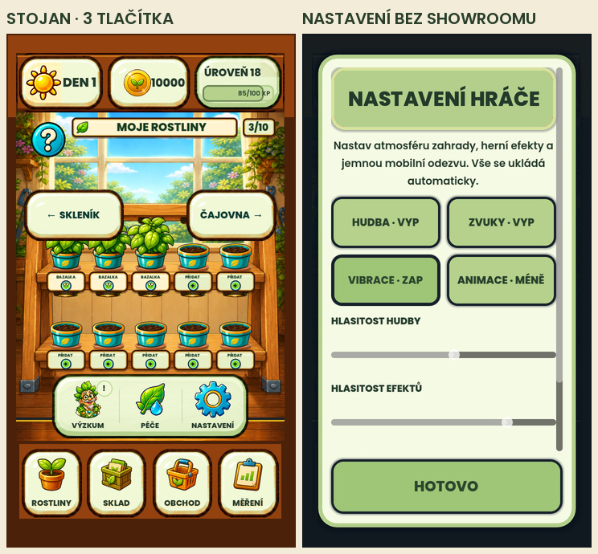

# Odstranění showroomu

## Následné schválení 28. 10. 2026

Uživatel následně schválil i tříikonovou lištu: „Ok tak pak tedy souhlasím“.
Záznam `approval.json` váže původní i schválený PNG pomocí SHA-256.
Aktivní obrazová brána teď používá přesně dříve předložený kandidát;
starý snímek, masky, ořezy a tolerance zůstaly beze změny. Níže je zachovaný
historický výsledek před tímto schválením. Aktuální společné ověření je
v auditu `../20261028-approved-delivery/`.

Uživatel výslovně schválil odstranění showroomu i všech vstupů do něj. Aktuální schválený malovaný vzhled a uložené nákupy se zachovávají.

## Změna ve hře

- Showroom se nesestavuje a nemá modal, obsluhu nákupu ani otevření ze hry.
- Z nastavení zmizel vstup Vzhled pokoje; ze stojanu zmizela ikona Pokoj vedoucí do showroomu. Výzkum, Péče a Nastavení jsou vystředěné v původním malovaném provedení.
- V dílně ani starších komponentách pokoje nezůstává tlačítko či signál pro výběr vzhledu.
- Kocour používá stejnou svislou hranici podlahy nad zbývající lištou.
- Aktivní kronika nabízí devět dosažitelných cílů. Historický cíl Sběratel vzhledů se nenabízí; jeho vlastnictví a dříve získaný odznak zůstávají v modelu zachované. Výška stromu odpovídá skutečnému počtu medailonů.
- GameSession, formát uložení, uložené vlastnictví, vybraný vzhled a výpočet historických odznaků se nemění. Zvolený uložený vzhled se dál vykresluje.

## Kontroly a historie

Úzké kontroly ověřují nepřítomnost odstraněných metod a vstupů, zbývající nastavení a zálohy, přesouvání dekorací a zachování všech čtyř historických vzhledů po save roundtripu. Skutečný desktopový renderer zachytil stojan, nastavení, dílnu, skleník, péči a mapu ve třech velikostech (18 stavů bez chyb skriptů a hlášeného přetečení). Samostatně byla zkontrolována kronika.

Kronika má tři horní a tři spodní kontrolní snímky: [přehled](journal-top-bottom-review.jpg), [runtime metriky](journal-proof.json). V každé velikosti je devět medailonů, oba poslední cíle jsou celé dostupné posunutím a za poslední řadou zůstává jen 22 px odsazení.

Z aktivní obrazové matice byly vyřazeny pouze dva případy odstraněného showroomu. Zbývajících 52 případů, jejich limity, masky a PNG reference se nemění. [Záznam vyřazení](../../../.agents/skills/how-to-grow-validation/references/showroom-retirement-20261028.json) zachovává původní manifest, definice obou případů a kontrolní součty referencí. Vyřazená obrazovka se nevydává za úspěšně otestovanou současnou funkci.

Výsledky celé sady a obrazového porovnání budou v `validation.json`. Pracovní logy jsou místně v `.godot/showroom-removed-20261028/`. První průběžný snímkový běh odhalil starou vazbu kocoura na odstraněnou ikonu; po opravě byl celý průchod 18 stavů zopakován bez chyb skriptů. První úzký test odhalil dvě testovací fixture hledající odstraněné tlačítko; po změně na zbývající zálohu byl zopakován s kontrolou diagnostiky.

Neproběhl push, release ani instalace do telefonu či emulátoru. Kontroly používají oddělené QA profily; skutečný uložený postup se nepřepisuje. Nové rozložení lišty je zde předloženo k osobní vizuální kontrole; aktivní reference nejsou přepsané.

## Výsledek finálního ověření

- Kompletní sada: **9922 / 9922 funkčních kontrol prošlo**, bez chyb skriptů.
- Obrazové brány: **32 / 33 prošlo**, celkově **FAILED**.
- Původní zdrojový manifest potvrdil změny pouze v uvedených deseti UI souborech; veškeré assety a soubory modelu a ukládání jsou beze změny.
- [Strojový záznam](validation.json) obsahuje kontrolní součet runtime i cestu k úplnému reportu.

Jediná neprošlá obrazová brána je `phase163-rack-runtime-approved`: původní reference má čtyři ikony, aktuální stojan po odstranění vstupu do showroomu tři. MAE 4,581194, RMSE 26,735735, změněno 4,1073 %; limity zůstaly beze změny. [Porovnání](rack-reference-comparison.png) potvrzuje hlavní rozdíl v této liště. [Přesný nový PNG kandidát](rack-three-actions-reference-candidate.png) je pouze podklad pro osobní schválení, nikoli nová aktivní reference. Celková obrazová validace je proto stále FAILED.

Finální úplný běh používá zdroj `b1b5b29a20d15d83d3be20f02578d8d429ef830798f569c8062cb6d8c8e728fb`, prošlo 9 922 funkčních kontrol a renderer uložil 180 diagnostických snímků bez chyb skriptů. Předchozí přerušené či neúspěšné běhy nejsou vydávány za PASS: následně se opravila historická validační podmínka pro vyřazené případy a dvě zastaralé UI podmínky počtu karet. Modelové kontroly deseti historických úspěchů zůstaly zachované.
