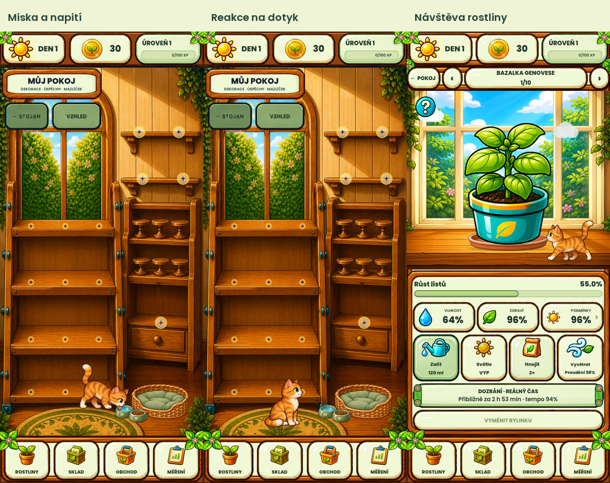

# Kocour v4 – návrh k osobnímu schválení

Rozšíření prototypu zachovává původní obrazovky, schválenou jemnou zelenou paletu a starší kočičí assety. Nový atlas je samostatný návrh, nikoli automaticky schválená reference.

## Co je hotové

- Klidnější chůze: plynulý rozjezd a zastavení, kroky odpovídají skutečně ušlé vzdálenosti.
- Napití: dojde k misce, malovanými snímky hýbe jazýčkem, na vodě se objevuje jemný kruh a poté dojde zpět. Miska nevyžaduje žádné placené doplňování.
- Pohlazení: krátké klepnutí na odpočívajícího kocoura v pokoji jej probudí a vyvolá spokojené mrknutí. Při chůzi/pití se akce nespouští; rychlé opakované klepání nemění běh animace. Tah prstu ani ovládací tlačítka nejsou pohlazení.
- Lehání má čtyři malované fáze; nad spícím kocourem zůstávají zzZZ.
- Při návštěvě detailu živé rostliny se zastaví u květináče, očichá jej a pokračuje ven. U prázdného květináče tuto akci nedělá.
- Původních sedm navštěvovaných míst zůstává; nejsou přidány povinnosti, bonusy, změny mincí, save schematu nebo automatické přepínání obrazovek.

## Vizuální ukázky

- [Napití a návrat](napiti.gif), 14 s.
- [Pohlazení, lehání a spánek](pohlazeni-a-spanek.gif), 9,8 s.
- [Návštěva květináče](ocichani.gif), 14 s.
- [Celý pokoj při napití – 432](room-drink-432.png) / [360](room-drink-360.png).
- [Celý detail](detail-sniff.png).

GIFy jsou výřezy skutečného vykreslení Godotu. Nejsou simulované mockupy. Přehrávají produkční rychlost a kód; demonstrační vstup přeskočí pouze dlouhou úvodní čekací dobu a zvolí pořadí akcí.

## Ověření

- Kompletní funkční sada: **MVP_TESTS_PASSED=7012**. Z toho 62 kontrol kocoura: průchod sedmi místy, scroll, dialogy, pozadí aplikace, omezené animace, neměnnost herního stavu, napití ve 360/432 a dotykový signál pokoje.
- Skutečný vstup vykresleného viewportu: **CAT_VIEWPORT_TOUCH=true**, výsledná póza `greet`.
- Vykreslení nových akcí: **CAT_LIFE_CAPTURE=PASSED; FRAMES=378; SNIFF=true**.
- Android emulátor API 36: instalace přes `install -r`, oba uložené soubory mají bezprostředně po instalaci shodné SHA256 se zálohou. Hra spuštěna, návratový přehled zavřen a pohlazení ověřeno skutečným kliknutím v okně emulátoru. Runtime log neobsahuje SCRIPT ERROR / Parse Error / FATAL EXCEPTION.
- Export: podpis, x86_64 ABI, payload, manifest, notifikace, privacy allowlist a 16K alignment prošly. Save schema zůstává 42.

**Vizuální výsledky jsou oddělené:** běžná plná obrazová brána má 27/34 úspěšných kontrol a 7 odlišností v pokoji (RMSE 14,378–14,637, změněná plocha 3,435–3,444 %). Rozdíly odpovídají přidané vrstvě kocoura, pelíšku a misek vůči starším referencím. Samostatná izolovaná kontrola původních obrazovek s vypnutou pouze kočičí vrstvou prošla **34/34**. Ta neznamená, že plná nová grafika už prošla původní bránou. Reference, limity a masky zůstaly beze změn; nové pózy a animace čekají na osobní schválení.

První úplný průchod odhalil chybějící technický profil nového atlasu v registru assetů; byl doplněn a úplná sada opakována úspěšně. Stávající diagnostické zprávy fixture obyčejných tlačítek o chybějících metadatech nejsou vydávány za chybu nového kocoura; nevyskytly se žádné chyby GDScriptu.

Lokální technické důkazy: `.godot/cat-companion-20261010/v4-validation-final/`, `v4-background/`, `v4-touch.log`, `v4-capture.log`, `v4-export-final.log`, `emulator-life-v4/`.

## Podklady a návrat

Nová grafika: `assets/pets/garden_cat_v4/cat_life_v4.png`, RGBA 1254 × 1254, 16 snímků. Režim **built-in Imagegen**, přesný prompt a reference v `assets/pets/garden_cat_v4/PROMPTS.md`; nativní alfa zachovaná. Původní tři PNG ve v1 mají původní SHA256. Kód je v samostatné komponentě `scripts/ui/garden_cat_companion.gd`.

Emulátor: `Bazal_Current_Source_API36`, `emulator-5556`, balíček `com.howtogrow.game`. Testovací APK: `builds/android/bazals-pocket-garden-cat-life-v4-emulator-debug.apk`, SHA256 `83C234C124FCF26F3E4308D000B05E79925E5E533ED08127AF2CF11644B35041`. Záloha předchozí instalace a obou save souborů je v `.godot/cat-companion-20261010/emulator-life-v4/`.

Telefon nebyl testován. Změny jsou lokální návrh, bez nového commitu, nahrání na GitHub či vydání releasu v tomto průchodu.

## Ke schválení

1. Styl a proporce nových malovaných póz.
2. Napití, plynulejší chůze a čtyři fáze lehání.
3. Pohlazení a klidná návštěva květináče.

Schválení těchto bodů samo o sobě není schválením přepsání regresních referencí; případná nová sada musí mít samostatný přesný doklad.
