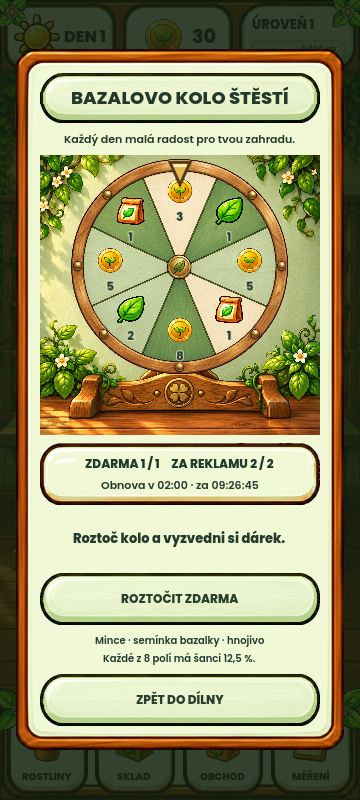

# Kolo štěstí – odsazení od rámu

Na žádost uživatele zvětšeno vnitřní odsazení dřevěného rámu z 12 na 24 px.
Nadpis, obrázek, informační panel a obě tlačítka sdílejí stejnou vnitřní hranu.
Velikost čtvercového obrázku se počítá z dostupné šířky po odečtení odsazení.
Na nejužším náhledu 320 px se nadpis bezpečně zalomí na dva řádky.

Ověření: nativní Godot 4.7, čtyři velikosti 320×711, 360×800, 432×960,
540×960. Capture kontroluje hranice ovládacích prvků a jejich nekolidování
s obrázkem. Běžné roztočení i výhra dokončeny. Exit 0,
`FORTUNE_WHEEL_NATIVE_CAPTURE=PASSED`, bez script/parse chyb.
Log: `.godot/fortune-wheel-padding-v3-20261011/capture.log`.
Použito izolované APPDATA, schválené reference zůstaly beze změn.
Jde pouze o rozložení; pravidla, grafické soubory a reklamní integrace nebyly měněny.
