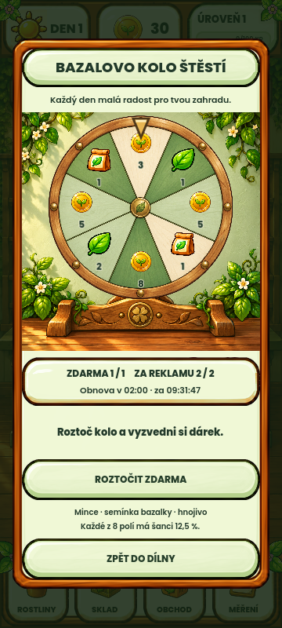
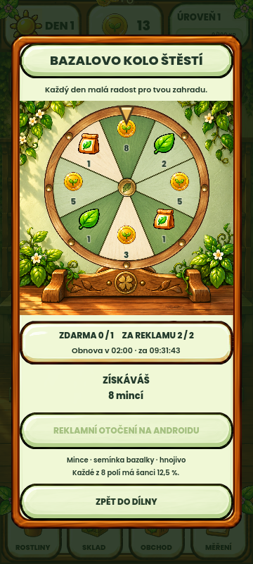

# Kolo štěstí – malovaný vzhled v2 ke schválení

Kolo stojí na malovaném dřevěném podstavci s drobným čtyřlístkem. Lístky,
bílé květy, zelená omítka a teplé dřevo navazují na schválenou Bazalovu dílnu.
Okno má výšku podle obsahu, na širokém displeji omezenou šířku a nevytváří
prázdné pásy kolem ilustrace. Odměny zůstávají čitelné během otáčení.

Změněna pouze prezentace v `fortune_wheel_face.gd` a sestavení dialogu
v `fortune_wheel_modal.gd`. Denní pravidla, odměny, ukládání, reklamní bridge
a malá ikona s časem resetu zůstaly stejné.

## Ověření 2026-10-11

- Nativní Godot 4.7 / OpenGL import a vykreslení: exit 0, bez script/parse chyb.
- Cílené funkční testy kola: `WHEEL_TESTS_PASSED=56 failures=0`, exit 0.
- Snímky 320×711, 360×800, 432×960 a 540×960 z aktuálního zdroje.
- Kontrola hranic obrázku, počítadel, textu i obou tlačítek; obrázek nepřekrývá počítadla.
- Běžné roztočení po dobu 3,8 s dokončeno, výhra a vyčerpané denní tahy zobrazeny.
- Vizuálně prohlédnuty čtyři velikosti a průběh i konec roztočení.
- Běhy používaly oddělené APPDATA. Schválené reference nebyly změněny.
- `git diff --check` bez chyb. Kompletní regresní sada v tomto čistě vizuálním průchodu nebyla opakována.
- Android ani fyzický telefon v tomto průchodu netestován; v2 není v dřívějším APK.
- Dřívější neúspěšné načtení oficiální testovací reklamy zůstává otevřenou integrační limitací; tento návrh nepotvrzuje přehrání reklamy.

Logy a pomocný capture skript jsou v `.godot/fortune-wheel-style-v2-20261011/`.
Nový podklad: `assets/ui/fortune_wheel/painted_stage_v2.png`, built-in imagegen.
Přesný prompt a reference: `assets/ui/fortune_wheel/painted_stage_v2.prompt.md`.
Původní disk `wheel_v1.png` zůstává zachován a rotuje odděleně od stojánku.
