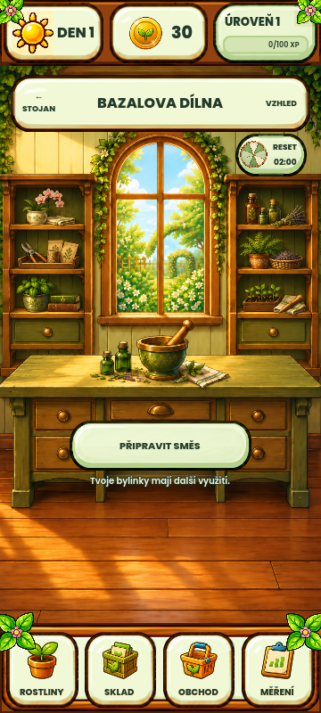
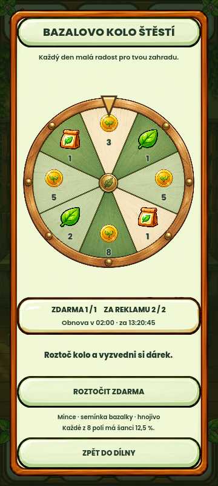
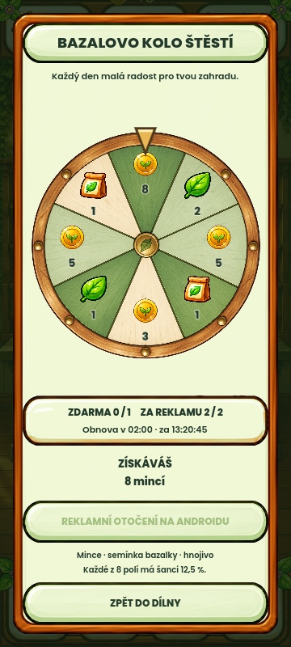

# Kolo štěstí – návrh ke schválení

Nová obrazovka a malá ikona nad pravou policí dílny. Původní malba dílny,
kocour, recepty a ostatní obrazovky zůstaly zachovány. Ikona ukazuje nejbližší
reset v místním čase, obrazovka také odpočet a zbývající denní tahy.

## Pravidla

1 otočení zdarma, 2 další za dokončené odměňované reklamy. Obnova denně
v 00:00 UTC, čas na ikoně se převádí do časového pásma zařízení. Mince,
semínka bazalky a hnojivo; stejná šance 12,5 % pro každé z osmi polí.
Podrobný rozpis je v [technickém popisu](../../FORTUNE_WHEEL.md).

## Ověření 2026-10-11

- Kompletní nativní sada: **MVP_TESTS_PASSED=7470**, exit 0.
  Log `.godot/fortune-wheel-20261011/complete-tests.log`.
- Z toho 56 nových kontrol kola: limity, restart, migrace, půlnoc, posun času
  zpět, selhání zápisu, dvojklik, duplicitní/cizí/opožděný callback, zrušená
  reklama, výměna profilu, read-only stav, animace a poloha ukazatele.
- Responzivní matice: **15/15**, report
  `.godot/responsive/20261011-102506Z/responsive-layout.json`.
- Nativní snímky kola/ikony ve 360×800 a 432×960; výhra i vyčerpaný den.
  **FORTUNE_WHEEL_NATIVE_CAPTURE=PASSED**, exit 0.
- Android Java část: `BUILD SUCCESSFUL`. APK export prošel kontrolou
  podpisu, ABI, payloadu, manifestu, SDK i zarovnání 16 KiB.
  `.godot/fortune-wheel-20261011/export-final.log`.
- Emulátor Android API 36, samostatný package `com.howtogrow.game.wheeltest`:
  otevření dialogu, jedno bezplatné otočení, výhra 8 mincí a restart s počtem
  mincí 38, free_used=true, ad_spins=0, bez rezervace. Důkaz:
  [android-review.json](android-review.json).
- Google testovací reklama se dvakrát nenačetla (`Ad failed to load : 3`).
  Oba reklamní tahy zůstaly zachovány. **Skutečné přehrání reklamy a earned
  callback od Google nejsou v tomto průchodu potvrzené.** Tyto větve jsou
  ověřeny automatickými testy se substituovaným providerem, nikoli vydávány
  za skutečné zobrazení reklamy.
- Testovací APK předchází poslednímu doplnění read-only guardu a přesnějšího
  textu chyby načtení; závěrečná nativní sada ověřuje finální zdroj.
- První software renderer emulátoru narazil na limit shaderových uniformů
  existující hry. Při opakování s host GPU se hra správně vykreslila.
- `git diff --check` prošlo. Schválené obrazové reference se neměnily;
  úplná stará golden sada nebyla aktualizována ani prohlášena za nový vzhled.

## Grafika

Nový malovaný disk vytvořil built-in image_gen, původní ikony odměn kreslí
Godot. Produkční soubor: [wheel_v1.png](../../../assets/ui/fortune_wheel/wheel_v1.png).
Přesný [prompt a původ](../../../assets/ui/fortune_wheel/wheel_v1.prompt.md).

Změny jsou připravené lokálně. Tento návrh není nová schválená golden
reference; neproběhl commit, push ani release.
