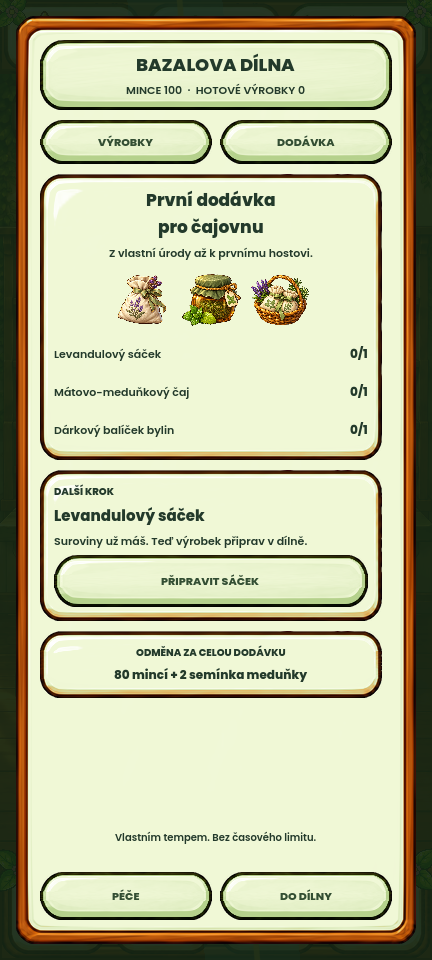

# Cesta vlastní bylinky do čajovny — návrh 24. 10. 2026

**Stav: oddělený hratelný návrh čekající na osobní schválení.** Schválené opravy z auditu jsou na GitHubu. Tento návrh není součástí hlavní scény ani Android APK a nemění hráčův postup.

## Co se mění v návrhu

Stávající jednorázová dodávka dostává jeden přehledný blok **Další krok**. Ze skutečných zásob pozná, zda bylinku potřebuješ vypěstovat, sklidit, usušit nebo zpracovat. Tlačítko tě dovede do odpovídajícího detailu, skladu nebo receptu. Po přípravě tří výrobků následuje obsluha hosta ve stávající spojovací minihře a předání dodávky.

- Původní tři výrobky, ceny, suroviny, kresby, fonty, rámečky a výrobní animace se přebírají z aktuální hry.
- Odměna zůstává původních **80 mincí + 2 semínka meduňky** za celou jednorázovou dodávku. Za samotné hraní se žádná další odměna nevytváří a zásoby se znovu neodečítají.
- Zavření rozehrané obsluhy dodávku nesplní. Připravené výrobky zůstanou hráči.
- Výsledná karta ukáže předané výrobky a převzatou odměnu; umožní návrat do zahrady.
- Návrh přidává obsluhu hosta jako podmínku této dodávky. Způsob běžného volného hraní v aktuální hlavní hře zůstává beze změn.

## Skutečný gameplay

[Video celé ukázky](cesta-bylinky-do-cajovny.mp4) zachycuje přijetí zakázky, zalití vlastní máty, sklizeň čtyř bylin, sušení, přípravu sáčku/čaje/dárku, skutečné tahy přes desku, držené nalévání, předání a odměnu.

Jde o nativní obraz Godotu 432×960 při 30 FPS s původní hudbou a zvuky hry. Video je přímo z Movie Makeru, není složené ze statických obrazovek. Zvuk má pouze upravenou hlasitost a omezené špičky; nebyl přidán dabing nebo jiná hudba. Z úvodu je odstraněno 0,8 s technické inicializace okna. Samotný průchod od přijetí po odměnu zůstává celý.

Ukázka začíná **připraveným profilem na úrovni 10 se čtyřmi zralými rostlinami**, nikoli zbrusu novým hráčem. Předvádí péči a využití úrody; neodehrává před kamerou celý několikahodinový růst od semínka. Sušení používá skutečný výpočet `advance_offline()` a ve videu je výslovně označené jako **časový střih**. Herní doby se v produkci nemění. Začíná se 100 mincemi, příprava stojí celkem 9 a po předání je 171.

## Ověření a hranice

- **48 kontrol průchodu**: skutečné vstupy do tlačítek a desky, sklizeň/sušení a uvolnění květináčů, výroba všech tří kusů, nulový dodatečný odběr zásob v minihře, bezpečné zavření rozpracované obsluhy, nalévání, jednorázové předání a načtení dokončené dodávky.
- **25 kontrol helperu a rozložení**: stavy výsadby/péče/sklizně/sušení/výroby, skutečné blokace a dostupnost ovládání na 432×960, 360×800, 360×640 a 600×900. Krátká obrazovka využívá běžný posuv.
- Samostatná kontrola prázdného šálku ověřuje návrat z výsledku, nulovou odměnu a zachované zásoby. Její testovací výsledkový stav je oddělený od skutečně odehraného receptu ve videu. `edge-checks.txt` obsahuje 9 opakovaných kontrol helperu a 3 kontroly tohoto okraje.
- `gameplay-verification.json`, `verification.json`, `runtime-checks.txt` a `layout-checks.txt` uchovávají průchod, měření média a výsledky. `prototype/` obsahuje celý návrh, čistý stavový helper a vstupní ovladač ukázky.
- Návrh se spouští výhradně s odděleným APPDATA pod `tmp/garden-teahouse-loop-v1`; entrypoint odmítne běžný hráčský adresář. Nezasahuje do profilu Android emulátoru.
- Nová informace „host obsloužen“ je v této ukázce **jen v paměti**. Po schválení je nutné navrhnout trvalý záznam, obnovení rozpracované obsluhy a migraci existujících dodávek. Nejde o dokončenou produkční integraci těchto pravidel.
- Schválené reference a produkční soubory se pro návrh nemění. Fyzický telefon nebyl testován. Kompletní sada hlavní hry není znovu spouštěna pouze kvůli izolovanému návrhu.

## Spuštění

`Spustit-navrh.ps1` otevře ovladatelný návrh v Godotu. Pro rychlé posouzení začíná interaktivní verze s připravenými suchými bylinami. Stačí přijmout dodávku, připravit tři výrobky, obsloužit hosta a předat ji.

Pro reprodukci videa spusť z kořene úplného projektu Godot 4.7 s izolovaným APPDATA obsahujícím `garden-teahouse-loop-v1`, parametry `--path . --fixed-fps 30 --write-movie tmp/garden-teahouse-loop-v1/gameplay-v2.avi --script res://docs/visual-proposals/20261024-garden-teahouse-loop-v1/prototype/review.gd`. Varianta `-- --layout-only` ověří rozložení bez záznamu. Vstupní skript ponechává produkční savy mimo tento adresář nedotčené.

Původní AVI a pracovní logy jsou v lokálním ignorovaném `tmp/garden-teahouse-loop-v1`. Do návrhu patří jen zkomprimované video, vybrané nativní snímky a zdroj ukázky; `.gdignore` jej odděluje od importu a exportu hlavní hry.
