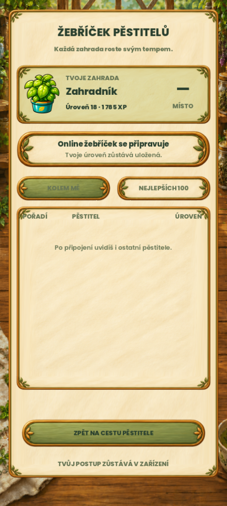

# Místní integrace žebříčku pěstitelů — 24. 10. 2026

Na základě schváleného malovaného návrhu je žebříček dostupný z Cesty pěstitele. Převzal skutečné XP a úroveň místní hry; služba má zatím stav „Online žebříček se připravuje“. Nevytváří pořadí, soupeře, účet ani síťové požadavky. Uživatel výslovně zvolil přípravu pouze místní části. Budoucí první online verze má zachovat dosavadní úrovně a být přátelským žebříčkem, nikoli serverově ověřenou soutěží.

Snímek používá izolovaný testovací profil úrovně 18. Nejde o veřejné pořadí ani o změnu hráčovy uložené hry.

## Co se změnilo

- Nová samostatná prezentační komponenta `scripts/ui/grower_leaderboard_panel.gd`, vstup z existující Cesty pěstitele a bezpečný návrat do ní. Hlavní spodní navigace zůstává stejná.
- Kratší displeje mají vlastní rozložení, tlačítka nejméně 48 jednotek, text alespoň 12 a vnitřní odstup seznamu. Ověřené rozměry: 432×960, 360×640, 360×800 a 600×900 včetně bezpečných okrajů a změny velikosti za běhu.
- Opakované předání stejných dat zachová ovládací prvky, rozpracovaný dotyk a posunutí seznamu.
- Android Zpět používá jedinou obsluhu v hlavní scéně s krátkou ochranou proti duplicitní notifikaci. Emulátor skutečně posílal dvě notifikace přibližně 8 ms po sobě; jedna fyzická akce nyní odebere jednu vrstvu, aniž by následná duplicita zavřela rodiče nebo hru. Desktopový Escape zůstává samostatně ověřený.
- Cesta pěstitele už po úrovni 10 neslibuje nejvyšší dosaženou úroveň. XP i další úrovně pokračují podle dosavadních pravidel.
- Žádná změna uloženého formátu, pravidel XP, odměn, schválených obrázků ani referencí.

## Ověření

- Kompletní funkční sada finálního zdroje: **9163 kontrol PASS**, nativní exit 0, bez skriptových nebo parserových chyb. Spuštěno pomocí `tools/run_tests.ps1` s izolovaným APPDATA.
- Nový modul: **64 kontrol PASS**. Skutečné dotykové události, kolečko, podržený dotyk přes obnovu, dlouhá jména/velká čísla, čeština/angličtina, prázdná data, ochrana obnovy uložené hry a obě úrovně návratu. Test porovnává herní stav i bajty všech uložených souborů.
- Emulátor Android: **10 kontrol PASS** v samostatném balíčku `com.howtogrow.leaderboardqa`. Nativní tap, systémové Zpět, zachování běžící aplikace, tažení prstem, návrat mezi záložkami a zachované hashe hlavního save i zálohy. Testovací soupeři existují výhradně v QA harnessu, který se nekopíruje do produkce.
- QA APK používá standardní Godot šablonu. Nativní doplňky reklam a oznámení v ní nejsou přítomné a hlásí očekávané chybějící Java bridge; tento průchod ověřuje navigaci a dotyky, ne produkční reklamy/oznámení ani celý distribuční APK. Hlavní aplikace v emulátoru nebyla přeinstalována, fyzický telefon nebyl použit.
- Celý vizuální běh `.godot/validation/20261024-123520Z`: **33/34 bran PASS, celkově FAILED**. Jediný rozdíl showroomu je totožný s dřívější dokumentovanou opravou: MAE 14,091654, RMSE 35,357709, změněná plocha 26,9796 %. Stará reference ukazuje pokoj, současný showroom dílnu. Porovnání bylo prohlédnuto; reference ani limity nebyly změněny. Poslední změny obsluhy vstupu nemění kreslení a byly ověřeny kompletní funkční sadou i nativním průchodem.

Viz [podrobné výsledky](verification.json), [nativní kontroly](native-verification.json), [vizuální report](visual-report.md), [známé porovnání showroomu](showroom-known-difference.png), [malý telefon](03-maly-telefon.png) a [Android s označenými QA daty](04-android-qa-posun.png).

## Stav předání

Místní část je připravená. Online pořadí zůstává vypnuté podle rozhodnutí uživatele. Nevznikl žádný Supabase projekt, serverový účet, publikovaný hráčský profil ani nový release. Náhledy zde jsou důkazy aktuálního vykreslení, nikoli nové schválené regresní reference.
