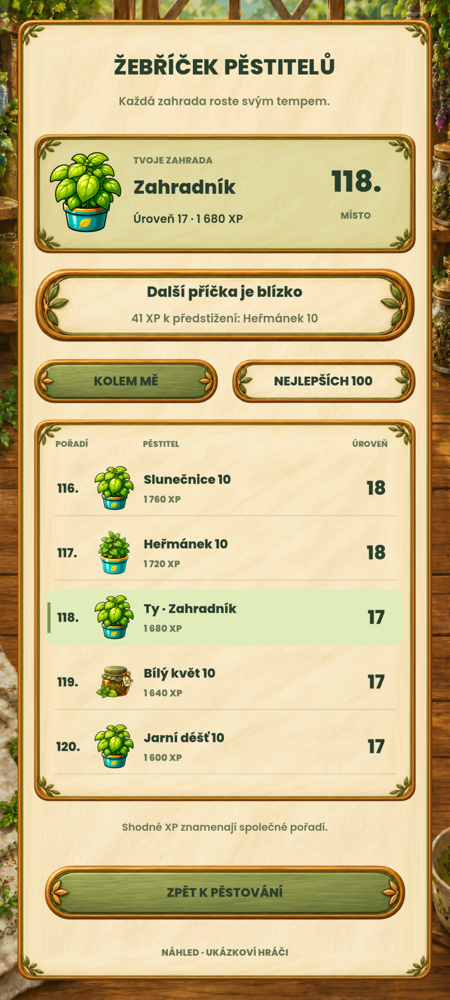

# Žebříček pěstitelů – návrh ke schválení

**Stav: ovladatelný návrh s ukázkovými hráči. Vzhled čeká na osobní schválení. Online služba není připojená a Android hra se tímto krokem nemění.**

Smyslem je dát další návštěvě zahrady dosažitelný cíl. Výchozí pohled ukazuje hráče těsně kolem vlastní pozice a počet XP k dalšímu posunu. Pěstitel tak nemusí být mezi první stovkou, aby viděl svůj postup. Nejlepší hráči mají druhou záložku, vlastní profil zůstává vidět v obou.

Záznam běžícího Godotu v 1080×2400, 30 fps, 16,2 sekundy, bez zvuku. Přepínání, posun seznamu a návrat používají skutečné vstupní události. Získání XP je výslovně simulované klávesou P, seznam obsahuje smyšlené profily. Nejde o video ze zařízení ani o důkaz připojené služby.

## Co návrh obsahuje

- Hlavní úroveň pěstitele a XP, stejné počítání úrovně jako v současné hře.
- Vlastní pořadí, sousední hráče, první stovku a společné příčky při stejných XP.
- Příklad postupu ze 118. na 117. místo, včetně změny úrovně 17 → 18 a nového nejbližšího cíle.
- Krátké zvýraznění při postupu, dostupné i s vypnutým efektem.
- Malované rámečky, jemnou zelenou a existující rostlinné portréty. Žádné nové bonusy.
- Ukázku přehledu bez připojení. Nejvyšší hráč nemá smyšleného soupeře před sebou.

## Ověření a hranice výsledku

Model prošel 137 kontrolami: řazení, shody, hranice seznamu, vlastní profil mimo stovku, překročení desáté úrovně, výpočet dalšího cíle, odmítnutí chybných dat a ochrana interních dat před přepsáním vrácených kopií.

Průchod vykresleným rozhraním prošel 102 kontrolami: skutečné kliknutí na záložky/návrat, posun seznamu kolečkem, zachování vlastní pozice, změna pořadí a úrovně, stav bez připojení a texty uvnitř vyhrazených ploch. Snímky byly vizuálně prohlédnuté. Výsledky a hashe jsou v `verification.json`; samostatná geometrie/dotyk v `layout-verification.json`.

Samostatně prošlo 180 kontrol geometrie, dotykových tlačítek a kolečka ve velikostech 432×960, 360×800, 360×640 a 600×900. **To není potvrzení pohodlného mobilního ovládání:** na 360×640 se taby zmenšují na 29,33 canvas jednotek a řádkový text na 8. Před integrací se musí doplnit rozložení pro kratší displej. **Tažení seznamu prstem zůstává neověřené**: přímý headless vstup selhal ve čtyřech rozměrech a dodatečný systémový průchod také neposunul seznam. Headless prostředí nehlásí dotykové zařízení; závadu Androidu z toho nelze potvrdit ani vyloučit. Původní neúspěšné kontroly zůstávají v `layout-diagnostics/` a nezapočítávají se do úspěšných výsledků.

Tento krok nepřepisuje produkční zdroje, assety, uložené hry ani schválené vizuální reference. Plná funkční regrese hry nebyla kvůli izolovanému návrhu znovu spuštěná; předchozí výsledek hry se nevydává za ověření nové online funkce. Nový release nevznikl. Zábavnost a osobní vizuální schválení nenahrazují automatizované kontroly.

## Další postup po schválení

1. Připojit vstup do žebříčku k existujícímu profilu/úrovni, aby nepřibyla další hlavní obrazovka v navigaci. Malovaný návrh převést na samostatnou produkční komponentu, přidat anglické texty, načítání a chybové stavy, pokrytí dlouhých jmen/čísel a dotyků na malém telefonu. Upravit dnešní hlášku o dosažení nejvyšší úrovně: herní XP ve skutečnosti pokračují i nad desítku.
2. Vybrat a zapojit online službu se stabilním účtem, přezdívkou a portrétem. Poskytovatel, účet ani žádné placené služby zde nejsou nově založené. Veřejný přehled potřebuje pouze přezdívku, portrét, XP/úroveň a pořadí, nikoli celý uložený profil.
3. Vyřešit důvěryhodnost výsledků a převod stávajících hráčů před zapnutím veřejného pořadí. Dnešní hra ukládá XP a čas lokálně; záloha s SHA-256 dokládá neporušenost, nikoli odehrání hry. Přihlášení a omezení počtu požadavků samy nedokážou pravost XP. Žádný tajný serverový klíč nesmí být v aplikaci.
4. Pro ověřené pořadí musí server evidovat a kontrolovat odměňované akce, jejich návaznost, zásoby a čas a odmítat opakované odměny. Přijmout konečné číslo XP z telefonu nestačí. Starý postup se nesmí tiše vynulovat ani označit za ověřený. Je potřeba výslovně zvolit přechod: přiznaně neověřený starý postup, nebo ověřovaný postup od začátku online evidence. To je samostatné produktové rozhodnutí; tento návrh ho nepředjímá.
5. Ověřit nové i existující účty, výpadek připojení, obnovu/import zálohy, duplicitní události, shody, větší počty hráčů a oba jazyky. Teprve poté zapnout skutečná data, kompletní regresi a Android test.

Zdrojové důvody: `scripts/game_session.gd` (`get_level`, `_grant_xp`, `from_dict`, `_claim_daily_challenge`), `scripts/save_manager.gd` (lokální soubory, přenosná záloha a offline čas), `scripts/ui/level_progression_presenter.gd` (text nejvyšší úrovně). Čajové hvězdy jsou jiný údaj než hlavní pěstitelské XP.
