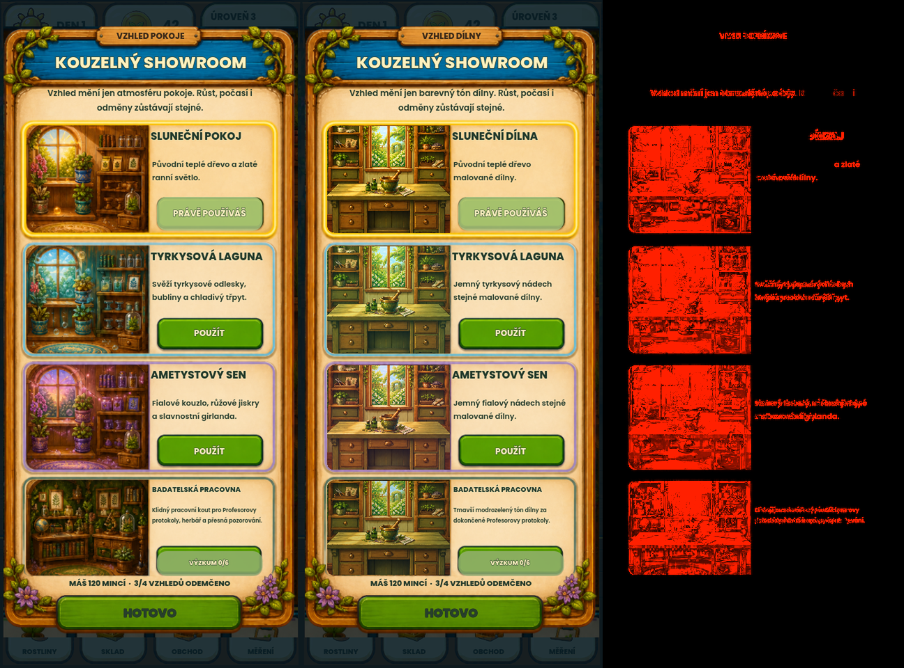

# Showroom – původní reference a aktuální kandidát

**Stav: PENDING – čeká na uživatelské schválení aktuálního kandidáta.**

**BASELINE NEZMĚNĚNA.** Reference, manifest, výřezy, masky ani prahy vizuální brány nebyly v tomto review změněny.

## Co se posuzuje

Pouze showroom vzhledů: čtyři náhledy používají skutečnou malbu dílny a odpovídající barevné tóny; živé nadpisy a popisy odpovídají současnému vzhledu. Schválení tohoto kandidáta dosud nebylo uděleno.

Historická oprava A03 vznikla v commitu `252566e49af0a4146534d8791db9930065df7097` (`fix(ui): resolve emulator navigation and tutorial audit findings`, 24. 10. 2026 04:55 +0200). Zavedla `scripts/ui/workshop_theme_preview.gd`, náhledy v `scripts/main.gd` a jejich obdélníky v `scripts/ui/cosmetic_showroom_visual.gd`; názvy/popisy v `scripts/game_session.gd` již neslibují neexistující bubliny a girlandu. Ceny, ID a podmínky odemčení zůstaly zachovány. Tato změna existovala už v HEAD `2ae007b` před nynější etapou čajovny.

## Přesné podklady

Zdroj: `.godot/validation/20261024-081152Z/report.json`, případ `phase162-cosmetic-showroom-runtime-approved`. PNG jsou zkopírována beze změny bajtů podle jeho polí `reference`, `actual` a `artifacts.comparison`.

| Soubor | Význam | SHA-256 |
|---|---|---|
| [reference.png](reference.png) | Původní schválená reference | `410dbea6fad1337ebb657bda2f0a0f7fa466e80b42ce5bec228a67cfca562dc7` |
| [actual.png](actual.png) | Aktuální kandidát k posouzení | `b767ddd11d3cfdf6902d2810e9516828e1a2357fca6a7cc292ef4108b6478618` |
| [comparison.png](comparison.png) | Přesné porovnání vytvořené validačním během | `523980e877fb5840914d59bc38720e7c18b76858930b305097c8e387bc93ee28` |

- Původní reference: `docs/audit/sage-palette-20261010/phase162-cosmetic-showroom-runtime-approved.png`.
- Aktuální snímek: `.godot/validation/20261024-081152Z/comic-phase162-cosmetic-showroom-selected.png`.
- Porovnání: `.godot/validation/20261024-081152Z/phase162-cosmetic-showroom-runtime-approved/comparison.png`.

Brána zůstává **FAILED**: MAE `14.091654` (limit `4.0`), RMSE `35.357709` (limit `12.0`), změněná plocha `26.9796 %` (limit `6 %`). Bez masek, tolerance pixelu `12`. Stejná odchylka je historicky zaznamenaná v `docs/audit/20261023-emulator-fixes/visual-report.md`.

Root návrhu obsahuje `.gdignore`; tyto review podklady nejsou novou runtime referencí.

