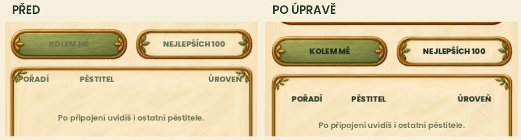

# Čitelnost a odsazení textu — 27. 10. 2026

Uživatel upozornil na slabý text záložky Kolem mě a záhlaví tabulky nalepené na malované lístky. Předchozí kontrola ověřovala hranice obrazovky, ale ne bezpečný prostor uvnitř ozdob. Nově se ověřují i celé nápisy vůči vnitřnímu prostoru tlačítek a tři sloupcové popisky vůči klidné ploše tabulky.

## Opravy

- Žebříček: tmavý neprůhledný text aktivních i nedostupných záložek; odstup od koncových ozdob podle skutečného rozměru malovaného proužku. Na krátké ploše se používá TOP 100, OPUSTIT/LEAVE a krátký návratový popisek, místo přetékání textu nebo zmenšování pod 12.
- Záhlaví tabulky je níže a dále od bočních lístků. Řádky i posuvník mají vlastní vnitřní odstup. Velikost dotykových ploch je zachovaná.
- Výpočet místa pro XP používá stejný tučný font jako výsledné vykreslení, takže anglický profil na úzkém displeji zbytečně neztrácí konec čísel.
- Společné styly tlačítek už nezprůhledňují zakázané nápisy na 45/54 %. Výslovně průhledné nativní texty pod samostatně kreslenou navigací zůstávají průhledné. Stav nedostupnosti nadále rozlišuje pozadí a skutečné disabled ovládání.
- Stejná úprava čitelnosti je také ve čajovně, minihře, dílně a výrobcích, kole štěstí a venkovních dekoracích skleníku.

Audit zahrnul aktuální sklad, obchod, měření, herbář, péči, denní výzvu, Cestu pěstitele, zakázky, nastavení, Profesora a čajovnu. Kontrolovaly se i starší diagnostické varianty; ty se nezaměňují za dnešní produkční obrazovky. Další zjevná kolize s ozdobou nebyla v prohlédnutých reprezentativních obrazovkách potvrzena. Nejde o tvrzení, že každý možný dynamický text celé hry má formálně dokázanou čitelnost.

## Ověření

- Kompletní funkční sada finálního zdroje: **9169 PASS**, nativní exit 0. Běžný testovací runner používá izolované APPDATA.
- Cílený render a ovládání žebříčku: **74 PASS**, včetně čtyř uložených PNG a testů při 432×960, 360×640, 360×800 a 600×900, bezpečných okrajů, češtiny/angličtiny, dlouhých hodnot, podrženého dotyku, posunu, Back a zachování session i uložených bajtů.
- Plný vizuální běh: **33/34 vynucovaných porovnání PASS**. Schválené reference ani prahy nebyly aktualizovány. Celkový stav porovnání je FAILED.
- `phase162-cosmetic-showroom-runtime-approved`: viz [phase162-cosmetic-showroom-runtime-approved](phase162-cosmetic-showroom-runtime-approved-comparison.png).

Známé porovnání `phase162-cosmetic-showroom-runtime-approved` nadále porovnává někdejší pokoj s již dříve opravenou dílnou. Nové zamýšlené změny čitelnosti se posuzují podle přiložených skutečných náhledů, nikoli přepsáním schválených referencí. Fyzický telefon ani aktualizace hlavního APK nejsou součástí tohoto průchodu.

Další náhledy: [malý telefon](03-zebricek-maly-telefon.png), [anglické rozložení](04-small-english-test-list.png), [zakázky](comic-customer-orders.png), [denní výzva](comic-phase161-daily-challenge-active.png), [nastavení](comic-audio-settings.png). Údaje soupeřů v náhledech jsou izolovaná testovací data, online pořadí zůstává nepřipojené.
